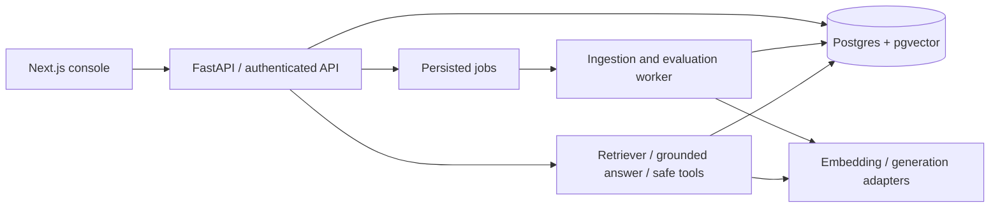

# EvalRAG architecture

## Intent and scope

Build a portfolio application demonstrating measurable RAG reliability. The supplied
PRD is the acceptance authority. Every required feature remains in scope, including
50–100 benchmark questions, two embedding models, agents, screenshots and a demo GIF.
Semantic chunking, BM25, reranking and enterprise SSO are optional.

## Selected design

An independently deployable modular monolith: Next.js → FastAPI → PostgreSQL with
pgvector, plus a worker using PostgreSQL jobs. This keeps ingestion/evaluation durable
without introducing Redis as a second persistence system. A microservice split would
increase failure surfaces before there is scaling evidence; a request-only API would
lose long evaluations on process restarts.

## Boundaries and data

- `config`, `db`, `models`: typed settings, transaction boundary, relational schema.
- `auth`: database-backed sessions; membership checks on every workspace resource.
- `ingestion`: bounded file parsing, page-aware text, token chunking and indexing.
- `providers`: HTTP adapters with explicit timeouts, usage, model and price metadata.
  OpenAI embedding small/large configurations are supported; an offline lexical
  backend, if offered, must be named honestly and not substituted for dense retrieval.
- `rag`: pgvector cosine retrieval; model-generated claims reference chunk IDs and
  verbatim evidence. Citation validation rejects unknown IDs and invented quotes.
  Citation existence/quote validation is deterministic; entailment is reported as
  an evaluator estimate, never implied by quote matching alone.
- `evaluation`: dataset revisions, immutable case snapshots/configuration/corpus
  manifests, individual results, aggregate metrics and regression gates.
- `tools`: allowlisted document search, metadata lookup and bounded arithmetic.
- `jobs`: leased, retryable ingestion/evaluation work; claim with SKIP LOCKED,
  lease recovery and idempotent result keys. Provider calls cannot hold DB locks.

Workspaces own knowledge bases, memberships and datasets. Knowledge bases record
embedding provider/model/dimension/index version and chunk settings. Documents are
unique by knowledge base/checksum; chunks have page, ordinal and token counts.
Query traces retain retrieval IDs, scores, citations, prompt/model versions, latency,
usage, cost and sanitized errors. Evaluation runs snapshot inputs before execution.
Updating a dataset or ingesting a document cannot silently alter an existing run.

## Reliability and security

Uploads are capped by bytes, pages and extracted text, with strict format validation.
Embedding vectors must have finite components and the expected dimension. Never mix
embedding spaces. All queries are scoped to a workspace and index version. Prompts
explicitly treat documents as untrusted data; tool permissions are enforced in code.
API sessions are opaque, hashed in the database, expiring and revocable. Secrets are
provided by environment. Correlation IDs and structured logs contain no document text.
Readiness checks database access. Metrics expose bounded-cardinality labels.

## Evaluation contract

Compute precision/recall/hit rate/MRR from unique expected sources, exact match from
normalized answers, semantic similarity only with a configured embedding evaluator,
citation coverage and verified-quote correctness separately from semantic support,
and p50/p95 latency, tokens, estimated provider cost and error rate. Missing ground
truth yields null metrics, not fabricated perfect scores. Regression comparison
requires matching dataset/corpus identity; reports quality drops and latency/cost
increases with explicit thresholds. All benchmark provenance is documented.

## Delivery and verification

Alembic migrations, non-root Docker images, Compose, CI tests/lint/frontend build,
image publishing configuration and deployment runbook. Test real PostgreSQL vector
search, transactions and constraints in addition to fast domain tests. Browser tests
cover ingest → query → citations → evaluate → compare. README contains measured
benchmark results, architecture, setup, design tradeoffs, screenshots and demo GIF.
